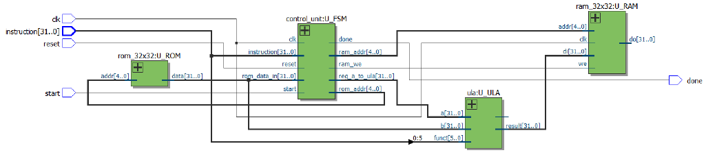

# Arquitetura de Computadores: MIPS simplificado em VHDL

Caminho de dados MIPS simplificado para quatro instruções aritméticas do tipo R (ADD, ADDU, SUB e SUBU), escrito em VHDL. Integra uma ROM de operandos, uma RAM de resultados, uma ULA de 32 bits com detecção de overflow e uma unidade de controle baseada em máquina de estados finitos (FSM). Dois testbenches conferem os resultados sozinhos e falham quando algo diverge.

*In English: a simplified MIPS datapath in VHDL for four R-type arithmetic instructions (ADD, ADDU, SUB, SUBU), with a 32-bit ALU with overflow detection, an FSM control unit, and self-checking testbenches.*

Trabalho do Laboratório de Arquitetura de Computadores (Engenharia de Computação, UFMT).



## Estrutura
- `arquivos_vhdl/`: módulos (`ula`, `control_unit`, `rom_32x32`, `ram_32x32`, `processador_top`), os testbenches, `gerar_rom.py` (gera a ROM) e `run.do` (script do Riviera-PRO).
- `relatorio_latex/`: relatório em LaTeX (`relatorio.tex`) e as figuras da arquitetura e das simulações.

## Verificação
- `testbench.vhd` (`tb_top`): executa 5 instruções no processador e compara o valor gravado em cada endereço da RAM e a flag de overflow com o esperado. Uma divergência gera `severity error` e o resumo final falha.
- `tb_ula.vhd` (`tb_ula`): testa a ULA isolada em 12 casos, incluindo overflow positivo e negativo no ADD e no SUB, carry no ADDU e resultado negativo no SUBU. A ROM do processador só tem operandos pequenos e positivos, por isso o overflow é testado na ULA.

Ao escrever os testbenches que conferem os resultados, apareceram dois bugs que se anulavam no relatório original: a ULA guardava o resultado num *signal* lido no mesmo processo (e devolvia o valor da operação anterior), e a FSM trocava o endereço da ROM no ciclo de escrita. Os dois foram corrigidos (`ula.vhd` e `control_unit.vhd`).

## Limites
É um caminho de dados de laboratório, não um processador completo: a instrução entra por uma porta do topo, e não há contador de programa, busca de instruções, banco de registradores, instruções de memória nem desvios. Os operandos vêm de uma ROM fixa e os resultados vão para uma RAM. O projeto foi só simulado, sem síntese em FPGA.

## Como executar
- **GHDL** (na pasta `arquivos_vhdl/`):
  ```bash
  ghdl -a --std=08 rom_32x32.vhd ram_32x32.vhd ula.vhd control_unit.vhd processador_top.vhd testbench.vhd tb_ula.vhd
  ghdl -e --std=08 tb_top && ghdl -r --std=08 tb_top --stop-time=2us
  ghdl -e --std=08 tb_ula && ghdl -r --std=08 tb_ula
  ```
- **Riviera-PRO** (Aldec), na pasta `arquivos_vhdl/`: `do run.do`. O relatório foi feito com o Riviera-PRO 2025.04 e o padrão VHDL-2019, no EDA Playground.
- **Relatório:** compilar `relatorio.tex` com `pdflatex` (classe IEEE).

O PDF do relatório não está versionado; gere-o a partir do `.tex`.
